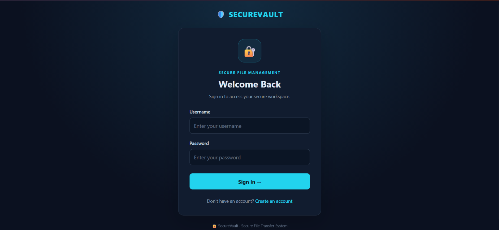
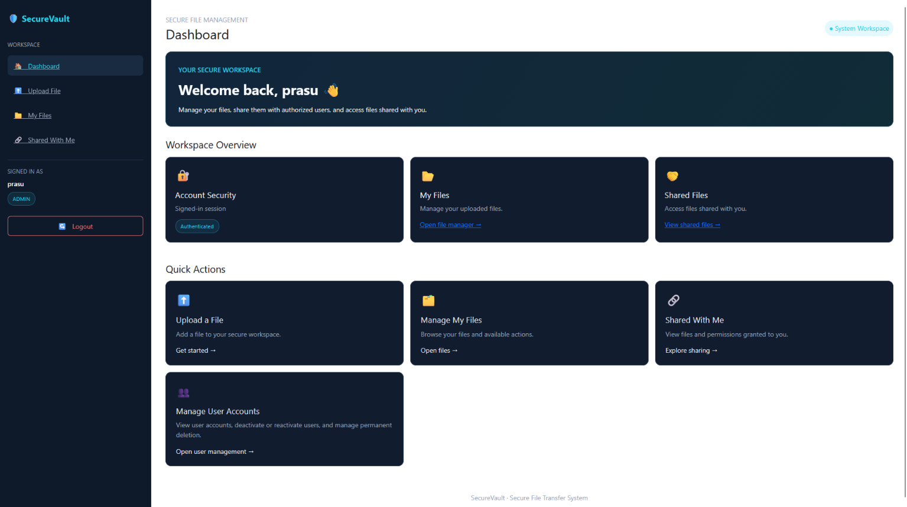
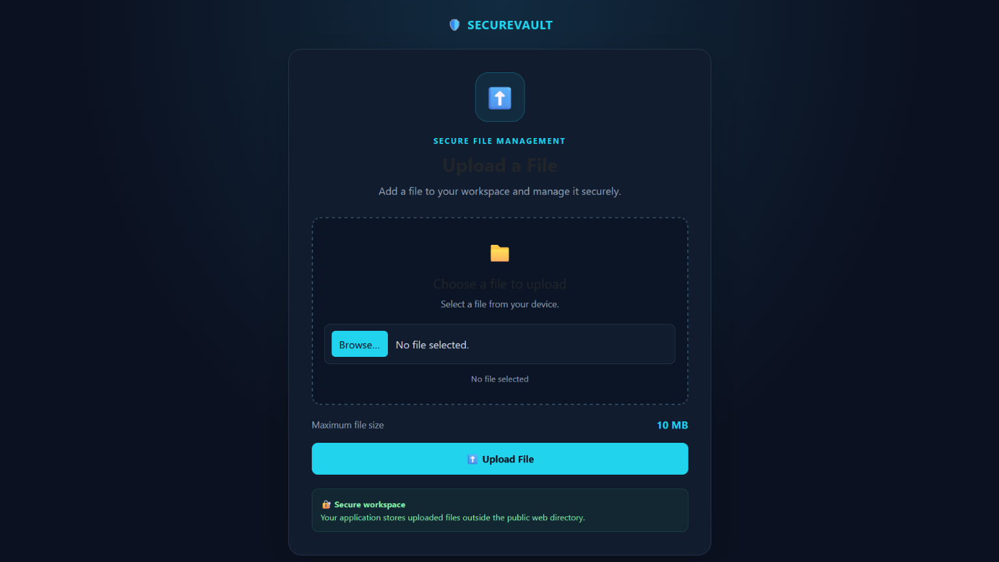
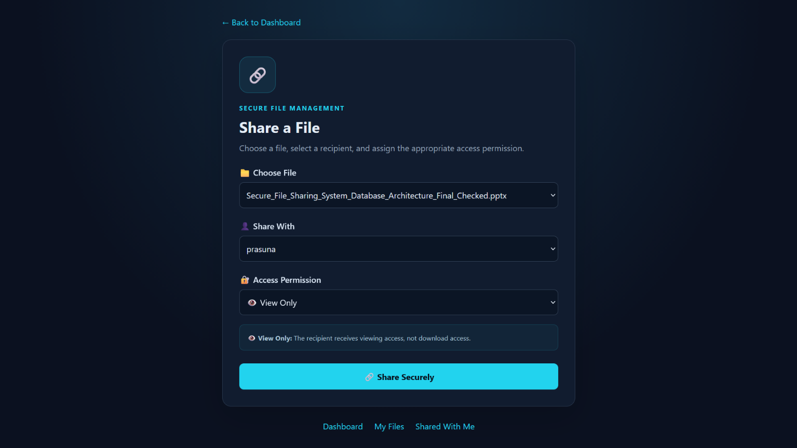
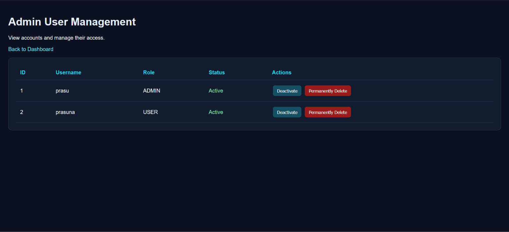

# 🔐 Secure File Transfer System

A Java-based web application designed to provide secure file storage, transfer, and sharing between users. Built using **Java, JSP, Servlets, JDBC, MySQL, and Apache Tomcat**, the system includes authentication, role-based access control, and administrative user management.

## ✨ Features

- 🔑 **User Authentication** — User registration and login with password hashing.
- 📤 **File Upload** — Upload and store files securely outside the web application directory.
- 📥 **File Download** — Access and download authorized files.
- 🤝 **File Sharing** — Share files with other registered users.
- 🛡️ **Role-Based Access Control** — Support for Admin, Manager, and User roles.
- 👨‍💻 **Admin Dashboard** — Manage user accounts, including activation and deactivation.
- 🗄️ **Database Integration** — Store user, file, and sharing information in MySQL.
- 📋 **Activity Tracking** — Database support for recording user and file activities.

## 🛠️ Technologies Used

- **Backend:** Java, Jakarta Servlets, JSP
- **Database:** MySQL
- **Database Connectivity:** JDBC
- **Server:** Apache Tomcat 11
- **Frontend:** HTML, CSS, JavaScript, Bootstrap
- **IDE:** Eclipse IDE
- **Security:** BCrypt password hashing and role-based authorization

## ⚙️ Setup Requirements

- Java JDK
- Eclipse IDE with Enterprise Java and Web Development support
- Apache Tomcat 11
- MySQL Server and MySQL Workbench
- MySQL Connector/J

## 🚀 Project Goal

The goal of this project is to develop a web-based file transfer platform that supports controlled file sharing, secure authentication, and user management while applying Java web development and database security concepts.

## 👩‍💻 Author

Developed as a learning project to explore Java web application development, database connectivity, authentication, and secure file management.

## 📸 Application Screenshots

### 🔐 Login Page

### 📊 User Dashboard

### 📤 File Upload

### 🤝 File Sharing

### 👨‍💻 Admin Panel

